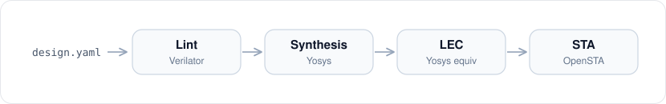

# BackFlow

**Front-end implementation flow automation — Lint → Synthesis → LEC → STA**

Open-source EDA flow structured after commercial tools (SpyGlass / DC / Formality / PrimeTime).
A new design needs only a YAML config; flow scripts contain no design-specific code.

- **One command per design** — runs all stages, judges each result, stops on failure
- **Same scripts, two designs** — gcd and aes differ only in `design.yaml`
- **Error injection tested** — injected RTL and netlist errors are caught by Lint and LEC

---

## Flow

<p align="center"></p>

`python runner.py <design>` reads `design.yaml`, runs the four stages in order, and writes
`results/summary_<design>.csv` — one row per design with the metrics below.

| Stage     | Stop on                  | Record                            |
|:----------|:-------------------------|:----------------------------------|
| Lint      | `%Error`                 | Warnings                          |
| Synthesis | `ERROR`, missing netlist | Area, warnings, check problems    |
| LEC       | Unproven compare points  | Proven count                      |
| STA       | Missing report           | WNS, TNS, violations by path type |

Tool errors stop the flow; quality metrics are recorded for review.
Old reports are cleared before each stage so a failed run is never judged from a stale file.

---

## Results

From [`results/summary_gcd.csv`](results/summary_gcd.csv) and [`results/summary_aes.csv`](results/summary_aes.csv).

| Design | Clock (ns) | Lint warn | Area (µm²) | LEC  | WNS (ns) | TNS (ns) |
|:-------|-----------:|----------:|-----------:|:----:|---------:|---------:|
| gcd    |       0.25 |        17 |      465.8 | PASS |   -0.571 |   -18.07 |
| aes    |       0.82 |         4 |   13,476.9 | PASS |   -0.326 |   -60.01 |

**Setup violations by path type**

| Design | Violations | r2r | i2r | r2o | i2o |
|:-------|-----------:|----:|----:|----:|----:|
| gcd    |         51 |  34 |   0 |  17 |   0 |
| aes    |        368 | 368 |   0 |   0 |   0 |

- **gcd** — violations in the subtractor datapath (r2r) and output paths (r2o)
- **aes** — all violations are register-to-register (round logic depth); IO paths are constrained and met
- Clock targets are aggressive benchmark values; STA is pre-layout (see Limitations)

---

## Error Injection Test

Errors were intentionally injected to confirm that each check fails when it should.

| Test       | Injection                              | Result                             |
|:-----------|:---------------------------------------|:-----------------------------------|
| Lint       | Syntax error in RTL                    | `FAIL`, synthesis not started      |
| LEC        | One `NAND2_X1` -> `NOR2_X1` in netlist | 20 unproven at `a_reg` input cone  |
| Regression | aes script changes re-run on gcd       | Caught an argument typo before aes |

---

## Usage

```bash
source env.sh             # tool paths and Python venv (see env.sh.example)
python runner.py gcd
python runner.py aes
```

**Adding a design** — put RTL and SDC under `designs/<name>/`, write `CFG/design.yaml`, run `python runner.py <name>`.

```yaml
top: aes_cipher_top
rtl_files:
  - ../RTL/aes_sbox.v
  - ../RTL/aes_rcon.v
  - ../RTL/aes_key_expand_128.v
  - ../RTL/aes_cipher_top.v
sdc: ../SDC/constraint.sdc
```

---

## Tool Mapping

| Stage     | This project    | Industry        |
|:----------|:----------------|:----------------|
| Lint      | Verilator       | SpyGlass        |
| Synthesis | Yosys           | Design Compiler |
| LEC       | Yosys `equiv_*` | Formality       |
| STA       | OpenSTA         | PrimeTime       |

Command-level mapping, design decisions, and SDC review: [docs/design_notes.md](docs/design_notes.md)
Issues and fixes: [docs/debug_log.md](docs/debug_log.md)

---

## Limitations

- Pre-layout STA — no SPEF, no wire load model, ideal clocks (optimistic)
- Nangate45 educational library, typical corner only
- Synthesis is not timing-driven — results are for analysis, not closure
- Benchmark SDCs lack driving cell, load, and clock uncertainty

## References

Designs and SDCs from [OpenROAD-flow-scripts](https://github.com/The-OpenROAD-Project/OpenROAD-flow-scripts) ·
Tools: [Yosys](https://github.com/YosysHQ/yosys), [OpenSTA](https://github.com/The-OpenROAD-Project/OpenSTA), [Verilator](https://github.com/verilator/verilator) ·
Library: Nangate45 Open Cell Library
